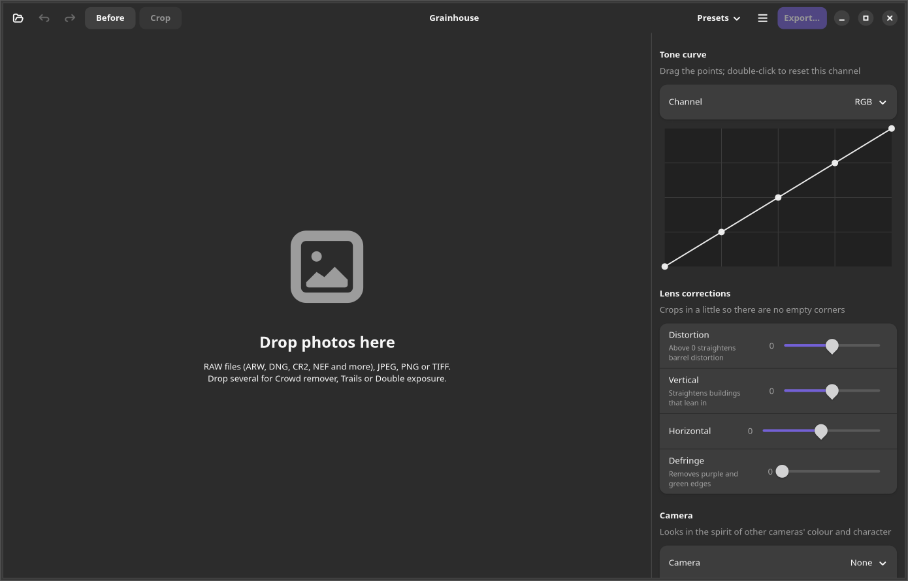
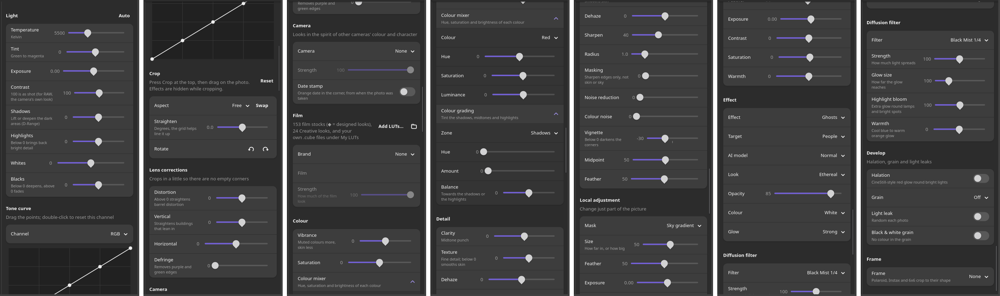
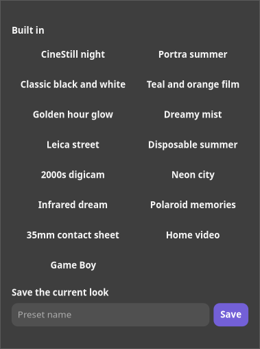
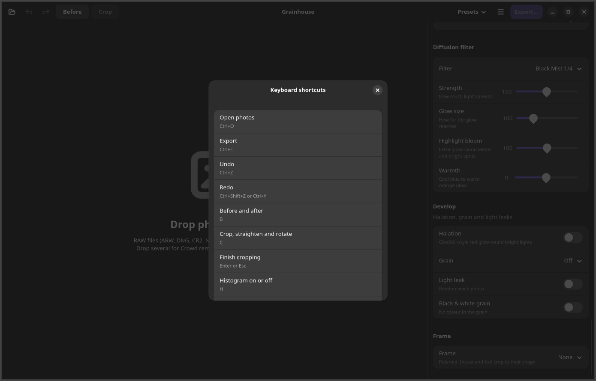

# Grainhouse

A photo editor for Linux with film looks, AI effects and proper editing tools, all in one window.

Drop in a RAW file or a JPEG, pick a film stock, push the light around, add an effect, and export. It does the everyday editing you'd do in Lightroom (white balance, tone curve, colour mixer, masks, noise reduction, lens corrections) and then the things Lightroom doesn't: 153 film stocks, camera looks, AI effects that find the people in your photo, diffusion filters, film frames, and Real-ESRGAN upscaling on export.

Everything runs on your own computer. No account, no cloud, no subscription.



## What it does

### Editing

- **Light**: white balance (presets or Kelvin, read from the camera for RAW files), tint, exposure, contrast, shadows, highlights, whites and blacks, plus an **Auto** button
- **Tone curve**: drag the points, for overall brightness or red, green and blue on their own
- **Crop**: drag on the photo, aspect ratios (1:1, 3:2, 4:3, 5:4, 16:9, 65:24 XPan), straighten and rotate
- **Lens corrections**: distortion, vertical and horizontal perspective, and defringe for purple and green edges
- **Colour**: vibrance, saturation, a colour mixer (hue, saturation and brightness for eight colours) and colour grading for shadows, midtones and highlights
- **Detail**: clarity, texture, dehaze, sharpening with radius and masking, noise reduction for brightness and colour, and vignette with midpoint and feather
- **Local adjustment**: change just part of the picture through a mask: the subject or the background (found by AI), a sky or ground gradient, or a radial area. Each has its own exposure, contrast, saturation and warmth



### Looks

- **153 film stocks** from Polaroid, Ilford, Kodak, Fujifilm and cinema film (CineStill, Vision3, Eterna and more), each with a strength control
- **24 creative looks**: teal and orange, bleach bypass, cross process, day for night, cinema print, neon noir, golden hour, Technicolor, cyanotype, selenium and more
- **Your own LUTs**: add `.cube` files, or a whole folder of them, and they show up under My LUTs. They're applied in full, so they look exactly as they should
- **Camera looks**: the colour and character of other cameras, from a Leica CCD or a Ricoh GR to a 2000s compact, a disposable, a Holga and a Game Boy Camera. With an optional orange date stamp in the corner, taken from when the photo was shot
- **Diffusion filters**: Black Mist, White Mist and Glimmer, with strength, glow size, highlight bloom and warmth
- **Develop**: CineStill-style halation, film grain and light leaks
- **Frames**: thin or gallery white border, black border, Polaroid, Instax, a 35mm film strip with sprocket holes and edge printing, a 6x6 negative, and cinema bars

### AI effects

The effects find the people (or vehicles, animals, anything) in your photo with a YOLO model running on your computer, then work around them.

| Effect | What you get |
| --- | --- |
| Ghosts | People become glowing white figures. Solid, Ethereal or Dreamy |
| Wireframe, Points | A triangle mesh or point cloud over each person, with a real face mesh on faces |
| Face mesh | The 478-point face mesh on every face, optionally with glowing eyes |
| Contours | Scan-line contours that follow the body |
| Skeleton | Neon stick figures from a pose model |
| Noir pop, Rim light, Bokeh | Colour people on black and white, backlit silhouettes, or the background thrown out of focus |
| Thermal, Glitch, Comic | A heat camera, a digital break-up, or pop art dots |
| Subject light | Brighten the subject, darken the background, or both |
| Zoom burst, Motion pan | A zoom, spin or panning blur behind a sharp subject |
| Neon edges, Pixel sort, 3D anaglyph | Glowing outlines, sorted pixel streaks, or red and cyan 3D |
| Infrared, Anamorphic flare, Light rays | Aerochrome-style false colour, blue streaks from bright lights, or rays from the brightest light |
| Tilt-shift, Duotone, Oil paint, Sketch | A miniature look, two-ink riso prints, oil or watercolour, pencil or charcoal |
| Mirror, VHS | Mirrors and kaleidoscopes, or a played-back tape with on-screen date |
| Crowd remover, Trails | Drop in several shots from a tripod: people walking through vanish, or stay as fading trails |
| Double exposure | Drop in two photos: the people in the first are filled with the second |

The first time an effect runs it takes a second or two to find people, then changes are quick. If it can't find anyone it says so and suggests what to try.

### Export

- JPEG, PNG or TIFF, at full size, a long edge in pixels, or a percentage
- **Real-ESRGAN upscaling** at 2x or 4x, with a fast model, a fast denoising model, or the slower x4plus for the best quality. The dialog tells you roughly how long it will take
- **AI sharpening** (upscale and back down) or smart sharpening
- Keeps the camera, lens, exposure and date in the EXIF, for RAW files too
- Export every open photo at once with the same settings

### Everything else

- **Presets**: 15 built in (CineStill night, Portra summer, Classic black and white, Disposable summer, 2000s digicam, Game Boy and more), and you can save your own
- **Undo and redo** for every change, a histogram, before and after, and keyboard shortcuts
- **Command line**: `grainhouse-cli` does everything the window does, for scripts and batches

<p>


</p>

## Installing

Download the latest release from the [releases page](https://github.com/jegly/grainhouse/releases).

**Ubuntu and Debian (.deb):**

```
sudo apt install ./grainhouse_1.0.1_amd64.deb
```

<!-- release-checksums:start -->
| File | SHA-256 |
|---|---|
| `grainhouse_1.0.1_amd64.deb` | *sha256:cf29a35f86caabbda0e9ecd354cf18054a722f71745ee4034981a72a65ed9595* |

Verify a download:

```bash
sha256sum grainhouse_1.0.1_amd64.deb
```

The [build attestation](https://github.com/jegly/Grainhouse/attestations) shows it was built by this repository's release workflow (with the GitHub CLI: `gh attestation verify grainhouse_1.0.1_amd64.deb --repo jegly/Grainhouse`).
<!-- release-checksums:end -->

**Snap:**

```
sudo snap install --dangerous grainhouse_1.0.0_amd64.snap
```

Then open Grainhouse from your app menu, or right-click a photo in Files and choose Open With Grainhouse.

## Using it

1. Drop photos on the window, or press Ctrl+O.
2. Work down the panel on the right. Every slider shows its value, and double-clicking a slider puts it back.
3. Press B to compare with the original, C to crop, and Ctrl+Z to undo.
4. Press Export, choose the size and whether to upscale, and you're done.

RAW support covers Sony ARW and most other cameras (DNG, CR2, CR3, NEF, RAF, ORF, RW2 and more). JPEGs are left exactly as they are until you change something.

Upscaling runs on the CPU. On a 6-core laptop the fast model takes about 14 seconds per megapixel of the photo you're upscaling, and x4plus about 4 minutes, so for big photos start with the fast one.

## Command line

```
grainhouse-cli photo.ARW -o out.jpg --film "Portra 400" --effect Ghosts --diffusion "White Mist 1/2"
grainhouse-cli photo.ARW -o out.jpg --auto --camera "Ricoh GR Positive Film-style" --upscale 2x
grainhouse-cli a.jpg b.jpg c.jpg -o out.jpg --effect Trails
grainhouse-cli photo.jpg -o out.jpg --settings my-look.json
grainhouse-cli --films
```

`--settings` takes a preset saved from the window (they live in `~/.local/share/grainhouse/presets`).

## Building

You need Rust (1.85 or newer) and the GTK 4 and libadwaita development files:

```
sudo apt install build-essential libgtk-4-dev libadwaita-1-dev
cargo build --release
```

That gives you `target/release/grainhouse` and `target/release/grainhouse-cli`. To add it to your app menu without a package, run `./install.sh` (and `./install.sh --remove` to take it out again).

The models are already converted and checked in under `assets/`. To convert the Real-ESRGAN weights again you need Python with `torch` and `onnx`, then `python tools/esrgan_to_onnx.py`.

`cargo run --release --no-default-features --example sheet -- photo.jpg out.jpg effects` renders every effect side by side, which is how the looks were tuned. Other sheets are `cameras`, `new`, `creative`, `adjust` and `frames`.

## How it works

- Written in Rust with GTK 4 and libadwaita. The window is `src/main.rs`; everything else is a library the command line tool uses too.
- RAW files are decoded by rawler, then developed in linear light: white balance, exposure, shadows and highlights (with an edge-aware filter, so there are no halos), then a tone curve.
- The film stocks are a tone curve plus a colour matrix each. Creative looks, the colour mixer and colour grading are worked out in the Oklab colour space and baked into a 3D LUT, so they stay fast at full size.
- The AI runs on a small inference engine written in C (`engine/`), with YOLO11 for people and poses and MediaPipe for faces. It runs once per photo, and the results are kept while you change everything else.
- Upscaling runs Real-ESRGAN through ONNX Runtime, in tiles, so any size photo works.
- The preview works on a 2560 pixel copy, so sliders answer quickly, and export works at full size.

## Credits and licence

- YOLO11n-seg and YOLO11n-pose by [Ultralytics](https://github.com/ultralytics/ultralytics), AGPL-3.0
- Face detector, face landmark model and face mesh by Google [MediaPipe](https://github.com/google-ai-edge/mediapipe), Apache-2.0
- [Real-ESRGAN](https://github.com/xinntao/Real-ESRGAN) by Xintao Wang and others, BSD-3-Clause
- [rawler](https://github.com/dnglab/dnglab) for RAW files, LGPL-2.1
- [ONNX Runtime](https://onnxruntime.ai) through [ort](https://github.com/pykeio/ort)

Because it ships the YOLO models, Grainhouse is licensed under the AGPL-3.0. See `LICENSE` and `NOTICE`.
